

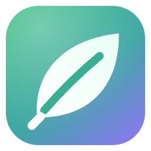

# Nutrition OS

**Progress without punishment.**
A private, local-first Windows app for nutrition, movement, habits, mood, sleep and hydration,
built for a *balanced* relationship with food rather than a diet tracker.

### [⬇ Download the latest version](https://github.com/Trapilaos/nutrition-os-releases/releases/latest)

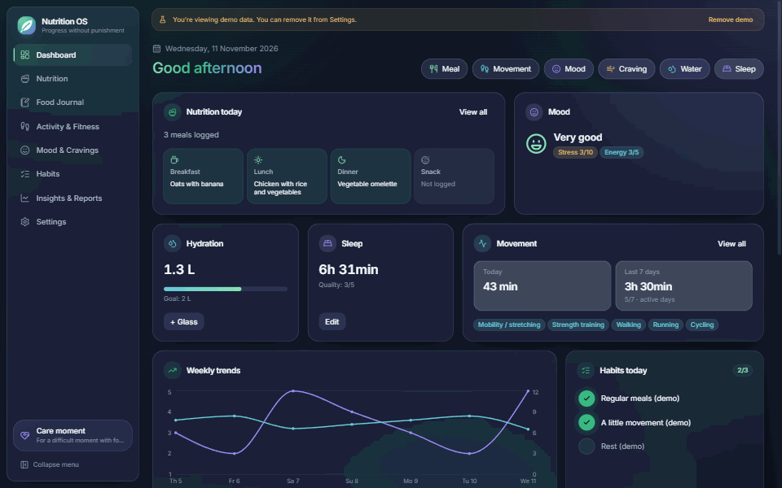

---

## Why it's different

Most nutrition apps are built around restriction: calorie budgets, red numbers, streaks you can lose.
Nutrition OS is designed around the opposite idea:

- **No calorie targets, no "exercise debt", no compensation maths.** Calories are shown only as information, and only when you choose to enter amounts.
- **No streak guilt.** Habits never "fail". Un-ticking a day simply removes it, and missed days are just days.
- **Achievements reward consistency, never weight or calories**, and what you earn can't be lost.
- **A Care moment** (Recovery Mode) for difficult moments with food: reassurance, a guided breathing exercise and gentle next steps.
- **Insights describe patterns, not causes.** They use minimum sample sizes and always say they are correlations within your own data.
- **Your data never leaves your computer.** No account, no analytics, no cloud.

## Features

<table>
<tr>
<td width="50%">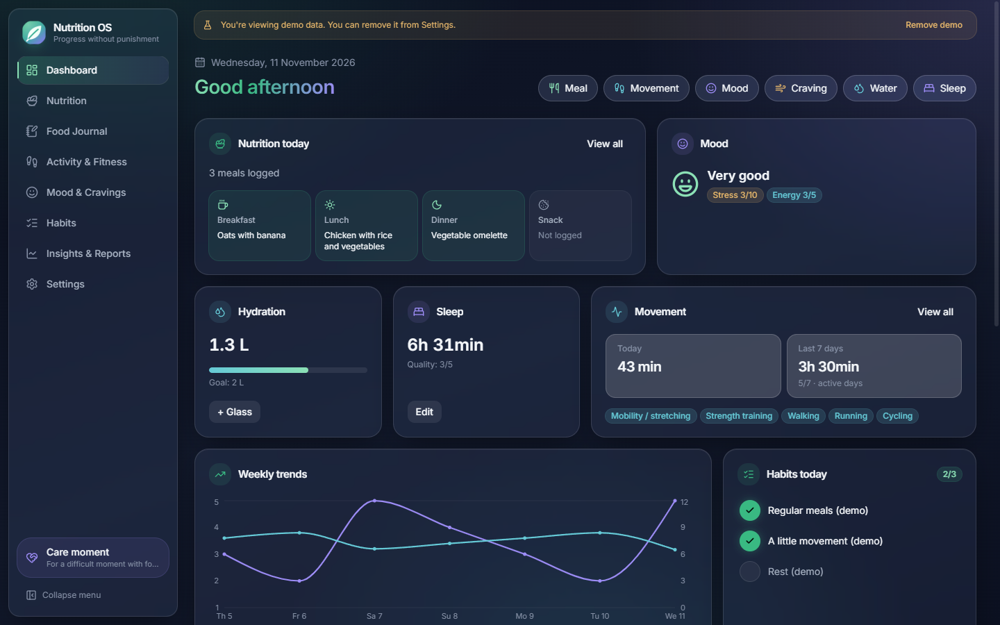 <b>Dashboard</b>: today at a glance with quick-log buttons for meals, movement, mood, cravings, water and sleep.</td>
<td width="50%">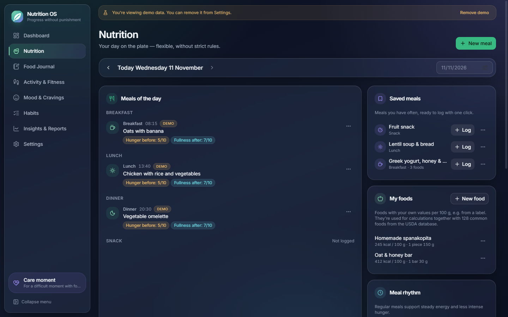 <b>Nutrition</b>: meals by time of day, meal rhythm, hunger and fullness, saved meals and your own foods.</td>
</tr>
<tr>
<td>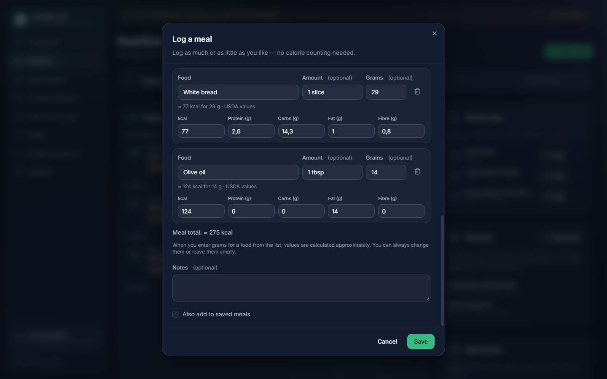 <b>Calorie calculation</b>: pick a food, enter grams, and kcal, protein, carbs, fat and fibre fill in. Always editable, with a meal total.</td>
<td>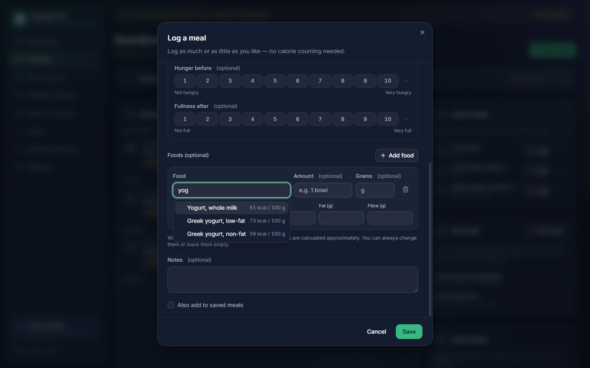 <b>Food search</b>: ~130 common foods in Greek and English (USDA FoodData Central) plus your own foods from a label. Accent- and case-insensitive.</td>
</tr>
<tr>
<td>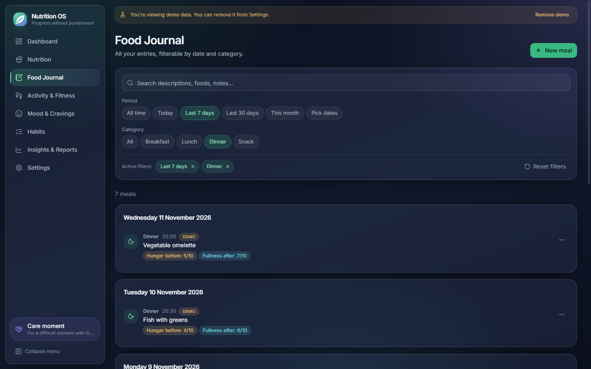 <b>Food journal</b>: full history with search, one-click period presets, category chips and removable filter chips.</td>
<td>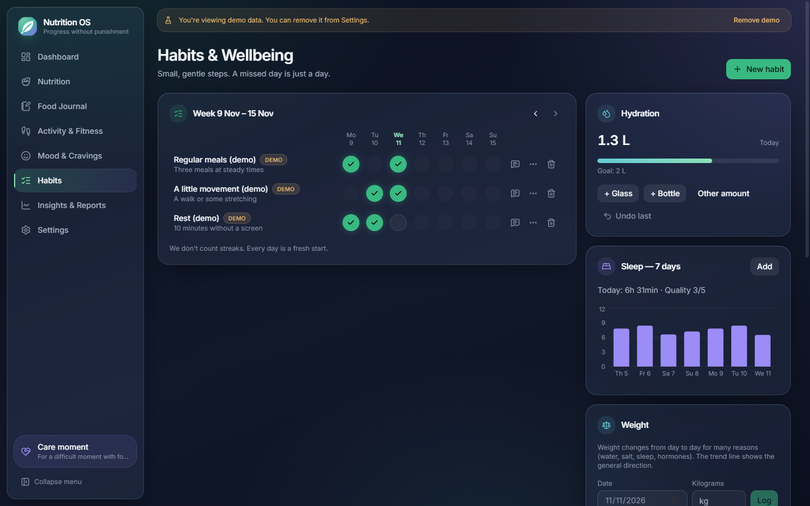 <b>Habits &amp; wellbeing</b>: a weekly habit grid without streaks, plus water and sleep tracking.</td>
</tr>
<tr>
<td>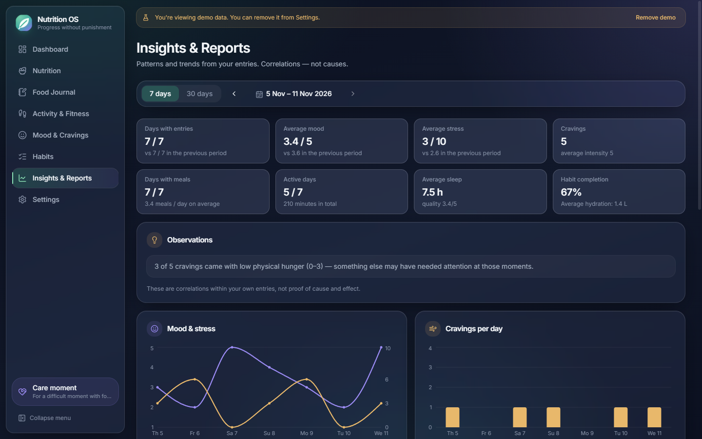 <b>Insights &amp; reports</b>: 7- and 30-day summaries, trends and observations, with comparisons to the previous period.</td>
<td>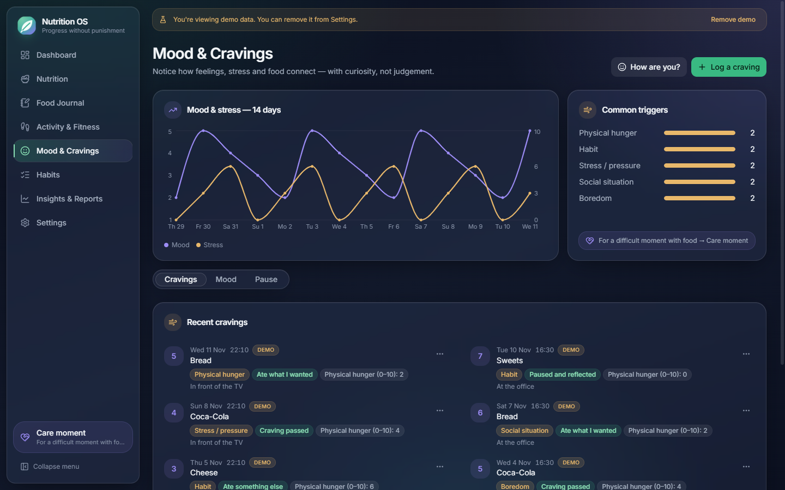 <b>Mood &amp; cravings</b>: notice cravings with curiosity (trigger, hunger, outcome) without labelling foods "bad".</td>
</tr>
<tr>
<td>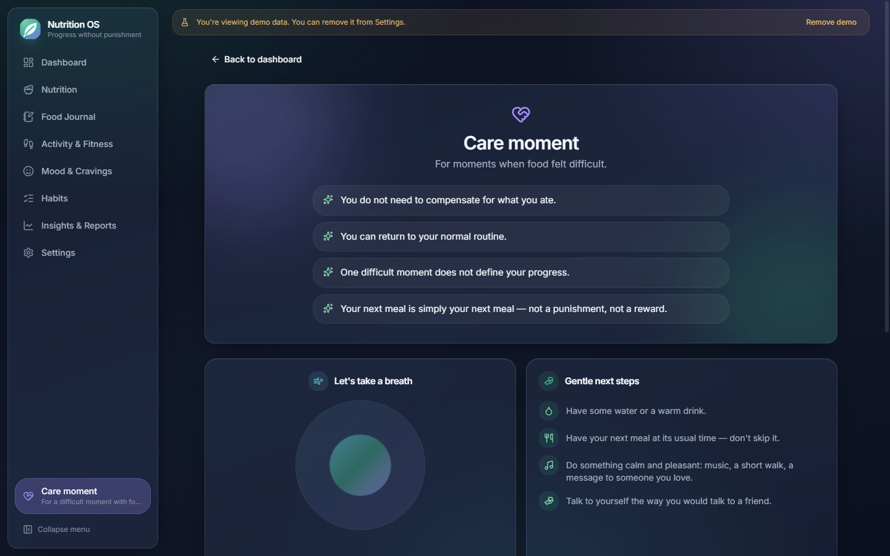 <b>Care moment</b>: a calm space for difficult moments: reassurance, breathing and gentle next steps.</td>
<td>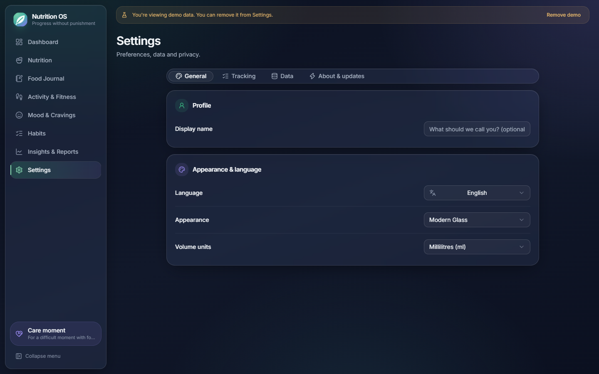 <b>Settings</b>: language, appearance, optional features, backups, restore, JSON export and in-app updates.</td>
</tr>
</table>

<table>
<tr>
<td width="62%">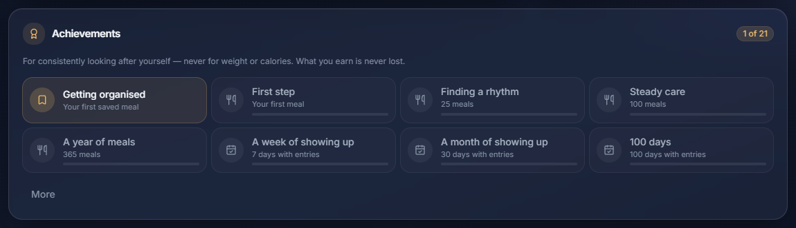 <b>Achievements</b>: 21 cumulative badges for logging consistently.</td>
<td width="38%">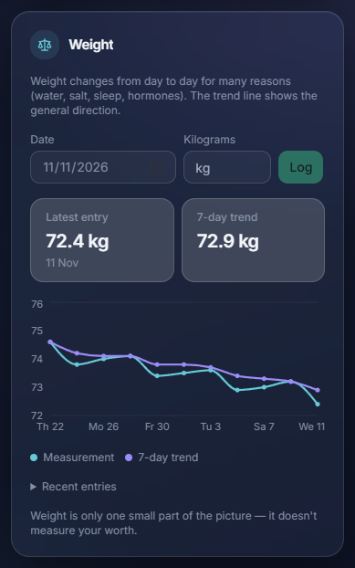 <b>Optional weight log</b>: off by default, with a smoothed 7-day trend and no goals.</td>
</tr>
</table>

<b>Greek interface (default)</b>

 
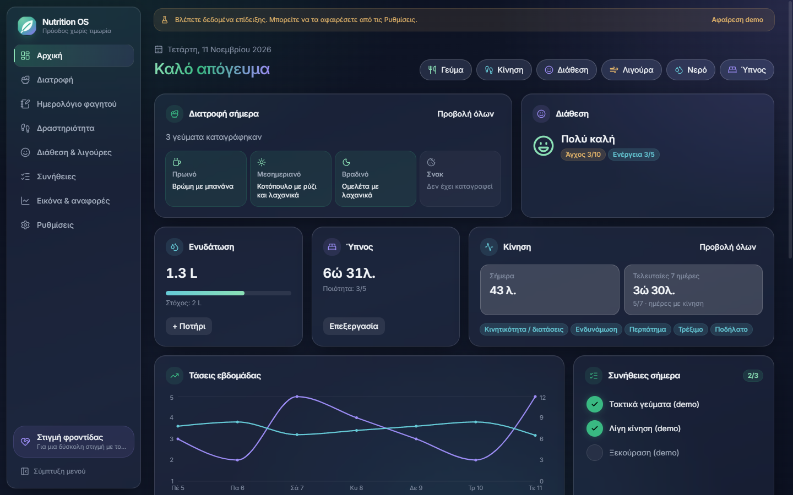

### Also

- **Greek by default, fully translated to English.** Typed translation keys, so no string can go missing.
- **Adaptive layout.** One, two or a full grid of columns depending on the window size, and the sidebar collapses on narrow windows.
- **Keyboard shortcuts**: <kbd>Ctrl</kbd>+<kbd>1…8</kbd> to switch sections, <kbd>Ctrl</kbd>+<kbd>N</kbd> for a new entry, <kbd>Ctrl</kbd>+<kbd>Shift</kbd>+<kbd>R</kbd> for a Care moment.
- **Backups you control.** One-click backup and restore, with integrity checks and an automatic safety copy before every restore, plus JSON export of everything.
- **Clearly labelled demo data** that can be loaded and removed without touching your own entries.
- **Signed in-app updates** from this repository.

## Tech stack

| Layer | Technology |
| --- | --- |
| Desktop shell | [Tauri 2](https://tauri.app) (Rust), WebView2 |
| UI | React 19, TypeScript, Vite, Tailwind CSS 4, shadcn/ui (Radix), Lucide icons |
| State & forms | Zustand, React Hook Form, Zod |
| Charts & dates | Recharts, date-fns |
| Database | SQLite via `rusqlite` (bundled), versioned migrations, WAL mode |
| Food data | USDA FoodData Central, SR Legacy (public domain) |
| Testing | Vitest (repositories run against real SQLite through sql.js and the same migrations), Rust unit tests |
| Distribution | NSIS and MSI installers, signed updates via `tauri-plugin-updater` |

### Engineering highlights

- **One schema, two runtimes.** The same `.sql` migrations are embedded in the Rust binary and imported by the TypeScript test suite, so the tests exercise the real schema.
- **Validation twice.** Zod schemas drive the forms *and* run again in every service before a write. SQLite `CHECK` constraints are the last line of defence.
- **"Not recorded" is not zero.** Missing measurements are stored as `NULL`, and analytics never treat a missing day as 0.
- **Safe restore.** The backup file's header, `integrity_check`, schema version and required tables are verified before it replaces the live database, and a safety copy is written first.
- **Minimal attack surface.** A small set of Tauri commands, least-privilege capabilities and a strict Content Security Policy. Fonts are bundled locally.

## Install

1. Download **`Nutrition.OS_x.y.z_x64-setup.exe`** from the [latest release](https://github.com/Trapilaos/nutrition-os-releases/releases/latest).
2. Run it. It installs for your user only, so no admin rights are needed. Greek and English installer languages are available.
3. Windows SmartScreen may warn about an unrecognised app because the installer isn't code-signed. Choose **More info → Run anyway**.

Updates install from inside the app: **Settings → About & updates → Check for updates**.
Your data is stored in `%APPDATA%\com.nutritionos.app\` and stays on your computer.

> This repository hosts the installers and update files. The application source code is private.

## Disclaimer

Nutrition OS is a personal wellbeing tool. It doesn't diagnose, and it isn't medical or nutritional advice.
If food, eating or your body feel hard to manage, please consider talking to a qualified professional.
